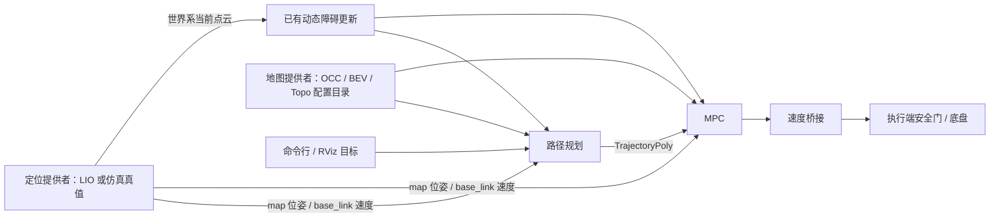

<!-- 文件用途：定义第二步导航解耦的替换边界、ROS2 数据契约及可复现实测方法。 -->
# 规划与 MPC 的外部接口

## 交付范围

原工程已经有独立的 `trajectory_generation` 和 `trajectory_tracking` 包。本次补齐独立启动入口、共享地图配置校验、坐标系检查和替换输入测试，保留哈工规划算法与 OCS2 SQP MPC 主体。



定位可以整体替换；静态地图可以通过一个配置目录替换。**实时点云到动态障碍的计算仍在规划器和跟踪器各自的地图类中**，本次没有新增通用在线障碍地图消息，更没有把一张 `OccupancyGrid` 当成 OCC/BEV/Topo 的等价替代。将来队友输出在线障碍地图时，需在地图边界增加适配器，并保留高度、膨胀、清除和拓扑语义；这部分属于后续联调。

## 独立启动

先加载 ROS Humble、工作区依赖和本次构建的安装目录：

```bash
source /opt/ros/humble/setup.bash
source /path/to/dependency/install/local_setup.bash
source ros2_ws/install_sentry_autonomy/local_setup.bash
ros2 launch sentry_bringup navigation.launch.py \
  map_profile:="$(ros2 pkg prefix --share sentry_gazebo)/maps/sentry_2024" \
  odom_topic:=/your_lio/odometry \
  cloud_topic:=/your_lio/world_cloud \
  goal_topic:=/goal trajectory_topic:=/global_trajectory \
  cmd_vel_topic:=/navigation/cmd_vel use_sim_time:=false
```

只启动规划器、MPC 和 `hit_bridge`；不启动定位、雷达、Gazebo、决策或 MCU。启动前校验地图，任一导航进程退出会关闭此组进程。`map_profile` 默认使用原地图；传入新地图目录后双方使用同一组文件和元数据。

独立入口使用现有算法速度配置，**输出是未经仿真安全门审核的导航请求**。必须由执行端负责超时停车、速度限幅、碰撞检查和人工接管；不要直接把该话题接到实车驱动。仿真入口仍使用原有 `autonomy_guard`，并采用较低速度配置。

## ROS2 契约

| 数据 | 默认话题 / 类型 | 提供者责任 |
| --- | --- | --- |
| 里程计 | `/localization/odometry` / `nav_msgs/Odometry` | `header.frame_id=map`，`child_frame_id=base_link`；pose 是机器人在地图中的姿态，twist 是机体系速度；真实时间戳、有限数值、持续更新 |
| 当前点云 | `/aligned_points` / `sensor_msgs/PointCloud2` | 当前观测在 `map` 系下的 XYZ，单位米；不是整张静态 PCD。非 map 帧必须提供对应时间的 TF，缺失变换会丢弃该帧 |
| 目标 | `/goal` / `geometry_msgs/PoseStamped` | `map` 帧、有限坐标且在地图范围内；当前位置和目标必须属于同一地图 |
| 规划轨迹 | `/global_trajectory` / `trajectory_generation/TrajectoryPoly` | 三次分段多项式、系数按降幂排列；消息无 frame 字段，约定为 `map`，空轨迹用于取消 |
| 速度请求 | `/navigation/cmd_vel` / `geometry_msgs/Twist` | `linear.x/y` 为 `base_link` 下全向速度；`hit_bridge` 不重复旋转；本入口不规划独立底盘 yaw |

里程计和点云订阅使用 SensorDataQoS，可连接 best-effort 或 reliable 发布者；目标、轨迹和速度使用 reliable。所有节点必须使用同一时间源；仿真传 `use_sim_time:=true` 并发布 `/clock`。RViz Fixed Frame 设为 `map`，2D Goal Pose 话题设为 `/goal`。

错误帧的目标会取消现有轨迹，越界或非有限目标也会取消；错误帧的里程计不会用于计算，跟踪器输出零速。定位模块必须完成真实坐标变换，不能只把 `odom` 的标签改成 `map`。完整速度旋转约定见 [Tracking Frame Contract](ros2_tracking_frame_contract.md)。

兼容的 `/clicked_point`、`/waypoints` 和 `/replan_flag` 输入仍保留；主输入和输出可由上表对应 launch 参数重映射。固定辅助话题包括 `/solver_status`、`/tracking/arrived`、`/sentry_des_speed`；一个 ROS domain 内只启动一组导航进程，或由调用方继续统一命名空间/重映射。

## 地图提供者契约

交付一个目录，包含 `map_metadata.yaml`、三张配对 PNG，以及可选的 `map_manifest.json`。没有 manifest 时默认文件名为 `occfinal.png`、`bevfinal.png`、`occtopo.png`；有 manifest 时在 `map_files` 中指定 `occupancy`、`bev`、`topology`。

- 参考 `ros2_ws/src/sentry_gazebo/maps/sentry_2024` 的实际格式。OCC 是原算法的占用编码，BEV 保留高度编码，Topo 保留骨架编码；不能随意转换为普通灰度图。
- 三张图尺寸、分辨率和原点必须一致。PNG 的列向右对应地图 +x，行向下对应 -y；地图范围以左下角原点加图像尺寸计算。
- YAML 保留规划器 `planner.*` 和跟踪器 `map.*` 两组原生参数，由共享 loader 校验语义一致。参数目录在启动时读取，替换地图需停止并重启两节点。
- RMUC2024 使用 301×161、0.1 m、原点 `(0,0)`，有效范围 `[0,30.1) × [0,16.1)` m。旧地图使用 400×400、0.05 m、原点 `(-13.394,-12.079)`。
- `sentry_map_profile.py` 在 ROS 进程启动前检查文件、尺寸、范围和两组元数据；C++ 节点也检查图像尺寸与地图范围，避免绕过新 launch 后误配。
- 仿真动态障碍保护半径按米换算：0.40 m 在 0.05 m 地图中为 8 格，在 0.1 m 地图中为 4 格。清除时间仍为 1 秒。规划仿真配置额外预留静态余量，其半径可大于安全门的基础半径。

## 分层验证

构建使用 `bash scripts/gazebo_autonomy.sh build`；依赖安装路径不同可设置 `SENTRY_DEPENDENCY_SETUP`。此脚本只构建导航仿真所需的六个包，复用已有 OCS2/HPIPM 等依赖。

```bash
# 加载上面的安装环境后执行
cd ros2_ws
colcon test --build-base build_sentry_autonomy --install-base install_sentry_autonomy \
  --packages-select trajectory_generation trajectory_tracking
ctest --test-dir build_sentry_autonomy/sentry_bringup \
  -R test_navigation_external_inputs --output-on-failure
python3 src/sentry_gazebo/scripts/test_map_geometry.py
```

外部输入测试把全部主要话题换成 `/external/*`，使用 best-effort 合成里程计/点云，运行真实规划器与 SQP 控制器，检查有效轨迹、非零速度和错误目标帧取消。它验证接口，不代表机器人移动或定位精度。

Ubuntu 图形桌面终端中运行 `bash scripts/gazebo_navigation.sh`，启动新地图、理想全向底盘、实际仿真雷达和真值里程计。另一个相同 ROS domain 的终端可运行：

```bash
export ROS_DOMAIN_ID=26 ROS_LOCALHOST_ONLY=1
export SENTRY_SIM_MAP="$(ros2 pkg prefix --share sentry_gazebo)/maps/sentry_2024"
python3 ros2_ws/src/sentry_gazebo/scripts/navigation_probe.py \
  --goal 4.95 7.55 --timeout 120 --output /tmp/navigation-goal.json
```

probe 不重置或移动模型，只发目标并记录实测里程计、点云帧、通过安全门的轨迹和到达状态；退出时请求停车。静态占用检查基于当前地图，不能替代完整物理碰撞验收。

本次实测数据见 [第二步验收记录](navigation_step2_acceptance.md)。批量成功率、正式 demo 视频、新场景 NDT/接触动力学以及队友 LIO/在线地图联调需分别验收，不能用旧地图的历史 15/15 结果替代。
